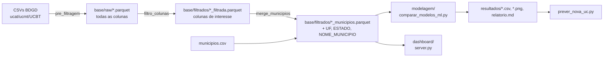

# ⚡ Consumo e Expansão do Mercado de Energia Elétrica no Brasil — BDGD/ANEEL

Projeto de TCC que usa a **BDGD (Base de Dados Geográfica da Distribuidora)** da ANEEL para analisar, no espaço, o consumo de energia das unidades consumidoras (UCs) de alta, média e baixa tensão no Brasil. O projeto:

1. **trata e reduz** as bases brutas da BDGD (≈ 11 milhões de UCs) a um formato analítico enxuto;
2. **compara algoritmos de Machine Learning espaciais** para prever o consumo de uma nova UC e a distribuição dos grupos de tensão em uma região;
3. **classifica os municípios** por consumo e ritmo de expansão;
4. **disponibiliza um painel interativo** (mapa + gráficos) e uma ferramenta de consulta por município.

---

## Sumário

1. [Motivação e hipótese](#-motivação-e-hipótese)
2. [Estrutura do repositório](#️-estrutura-do-repositório)
3. [Origem dos dados](#️-origem-dos-dados)
4. [Dicionário de dados e legendas](#-dicionário-de-dados-e-legendas)
5. [Pipeline de tratamento](#-pipeline-de-tratamento)
6. [Como executar](#-como-executar)
7. [Testes realizados](#-testes-realizados)
8. [Resultados](#-resultados)
9. [Conclusões](#-conclusões)
10. [Limitações e próximos passos](#️-limitações-e-próximos-passos)

---

## 🎯 Motivação e hipótese

A pesquisa parte de uma hipótese dupla:

1. **O mercado de energia elétrica está se descentralizando para o interior ou permanece concentrado nas grandes metrópoles do Brasil?**
2. **Como essa dinâmica está reconfigurando o mercado de energia e a demanda sobre as redes de distribuição?**

A etapa implementada neste repositório olha para o **lado do consumo** (tabelas `UCBT`, `UCMT` e `UCAT`). Ela identifica onde a energia é consumida, como os grupos de tensão se distribuem no território e quais municípios mostram sinais de expansão. A análise do **lado da geração** (tabelas `UGBT`, `UGMT`, `UGAT`, potência instalada e fontes renováveis) está nos [próximos passos](#️-limitações-e-próximos-passos).

---

## 🗂️ Estrutura do repositório

```
TCC_projeto/
├── base/
│   ├── raw/                        # BDGD convertida de CSV para Parquet (todas as colunas)
│   │   ├── alta_tensao.parquet     #   UCAT —      2.122 UCs, 101 colunas
│   │   ├── media_tensao.parquet    #   UCMT —    314.493 UCs,  80 colunas
│   │   └── baixa_tensao.parquet    #   UCBT — 10.633.671 UCs,  70 colunas
│   ├── filtrados/                  # Bases reduzidas usadas nas análises
│   │   ├── *_filtrada.parquet      #   colunas selecionadas
│   │   └── *_municipios.parquet    #   + UF, ESTADO e NOME_MUNICIPIO (base final)
│   └── municipios.csv              # Tabela IBGE de municípios (não versionada)
├── tratamento_base/
│   ├── pre_filtragem/              # 1. CSV → Parquet (base/raw)
│   ├── filtro_colunas/             # 2. Seleção de colunas (base/filtrados/*_filtrada)
│   └── merge_municipios/           # 3. Junção com a tabela de municípios (*_municipios)
├── overview/analise_dados_geral.py # Inspeção exploratória (tipos, nulos, cardinalidade)
├── modelagem/                      # Comparação de modelos de ML e previsões regionais
│   ├── comparar_modelos_ml.py
│   ├── prever_nova_uc.py
│   ├── resultados/                 # CSVs, gráficos e relatório gerados
│   └── README.md                   # Documentação detalhada da modelagem
├── dashboard/                      # Painel web interativo (servidor Python + Leaflet/Chart.js)
│   ├── server.py
│   ├── static/
│   └── cache/                      # Cache agregado gerado automaticamente (não versionado)
└── Manual_de_Instruções_da_BDGD (1).pdf
```

---

## 🛰️ Origem dos dados

| Item | Descrição |
| :--- | :--- |
| **Fonte** | BDGD — Módulo 10 do PRODIST (ANEEL), dados abertos |
| **Data-base** | 31/12/2025 (coluna `DATA_BASE`) |
| **Tabelas** | `UCAT` (alta tensão), `UCMT` (média tensão), `UCBT` (baixa tensão) |
| **Distribuidoras** | 40 com UCs em AT, 99 em MT e 98 em BT |
| **Arquivos de origem** | `ucat_pj.csv`, `ucmt_pj.csv`, `UCBT_PJ.csv` (separador `;`) |
| **Municípios** | `base/municipios.csv` — código IBGE, UF, nome do estado e do município |

> O sufixo `_PJ` dos arquivos de origem sugere um recorte da BDGD (por exemplo, apenas pessoas jurídicas). Isso é compatível com a pequena participação da tarifa residencial (B1) na baixa tensão. Confirme a forma de extração antes de generalizar os números para todo o mercado.

**Volume após o tratamento:**

| Base | UCs | UCs ativas (`SIT_ATIV = AT`) | Municípios | Energia anual medida |
| :--- | ---: | ---: | ---: | ---: |
| Alta tensão (AT) | 2.122 | 1.983 | 767 | 88,9 TWh |
| Média tensão (MT) | 314.493 | 288.864 | 5.221 | 145,7 TWh |
| Baixa tensão (BT) | 10.633.671 | 9.251.065 | 5.550 | 35,1 TWh |
| **Total** | **10.950.286** | **9.541.912** | **5.571** | **269,7 TWh** |

Só 0,02% das UCs atende em alta tensão, mas esse grupo responde por **33% da energia**. A média tensão concentra **54%**, e a baixa tensão, com 97% das UCs, consome **13%**.

---

## 📖 Dicionário de dados e legendas

### Colunas das bases finais (`base/filtrados/*_municipios.parquet`)

| Coluna | Tipo | Descrição | Origem |
| :--- | :--- | :--- | :--- |
| `MUN` | texto | Código IBGE do município (7 dígitos) | BDGD |
| `GRU_TEN` | código | Grupo de tensão da UC (ver legenda) | BDGD (`TGRUTEN`) |
| `GRU_TAR` | código | Grupo/subgrupo tarifário da UC (ver legenda) | BDGD (`TGRUTAR`) |
| `SIT_ATIV` | código | Situação de ativação da UC (ver legenda) | BDGD (`TSITATI`) |
| `DAT_CON` | texto `DD/MM/AAAA` | Data de conexão (ligação) da UC | BDGD |
| `ENE_01` … `ENE_12` | decimal (kWh) | Energia ativa medida em cada um dos 12 períodos (meses) — **MT e BT** | BDGD |
| `ENE_P_01` … `ENE_P_12` | decimal (kWh) | Energia ativa medida **na ponta** em cada período — **apenas AT** | BDGD |
| `ENE_F_01` … `ENE_F_12` | decimal (kWh) | Energia ativa medida **fora de ponta** em cada período — **apenas AT** | BDGD |
| `POINT_X` | decimal | Longitude da UC (graus decimais) | BDGD |
| `POINT_Y` | decimal | Latitude da UC (graus decimais) | BDGD |
| `UF` | inteiro | **Código IBGE** da UF (ex.: 35 = SP). Os scripts de consulta e o painel convertem para a sigla | `municipios.csv` |
| `ESTADO` | texto | Nome do estado | `municipios.csv` |
| `NOME_MUNICIPIO` | texto | Nome do município | `municipios.csv` |

> **Energia anual de uma UC** = soma dos 12 períodos. Na alta tensão, soma-se ponta + fora de ponta (`ENE_P_xx + ENE_F_xx`). A parcela fora de ponta é cerca de 10× maior que a de ponta (81,1 TWh contra 7,8 TWh).

### Legenda — `GRU_TEN` (grupo de tensão)

Faixas de tensão nominal definidas no PRODIST, Módulo 1.

| Código | Significado | Faixa de tensão |
| :--- | :--- | :--- |
| `AT` | Alta tensão | ≥ 69 kV |
| `MT` | Média tensão | > 1 kV e < 69 kV |
| `BT` | Baixa tensão | ≤ 1 kV |

### Legenda — `GRU_TAR` (grupo tarifário)

Subgrupos definidos na Resolução Normativa ANEEL nº 1.000/2021. O Anexo II do DDA, que traz a tabela `TGRUTAR`, não está incluído no PDF do repositório. Os códigos marcados com \* foram interpretados pelo sufixo e devem ser confirmados nesse anexo.

| Código | Grupo | Significado |
| :--- | :--- | :--- |
| `A1` | A (alta/média tensão) | Tensão de fornecimento ≥ 230 kV |
| `A2` | A | 88 kV a 138 kV |
| `A3` | A | 69 kV |
| `A3A` | A | 30 kV a 44 kV |
| `A4` | A | 2,3 kV a 25 kV |
| `AS` | A | < 2,3 kV, atendida por sistema subterrâneo |
| `B1` | B (baixa tensão) | Residencial |
| `B1BR`\* | B | Residencial baixa renda |
| `B2RU`\* | B | Rural |
| `B2CO`\* | B | Rural — cooperativa de eletrificação rural |
| `B2SP`\* | B | Rural — serviço público de irrigação |
| `B3` | B | Demais classes (comercial, industrial, serviços, poder público etc.) |
| `B4A` | B | Iluminação pública — rede de distribuição |
| `B4B` | B | Iluminação pública — bulbo da lâmpada |
| `0` / `N/D` | — | Não informado (registro sem grupo tarifário válido) |

O grupo tarifário nem sempre coincide com o grupo de tensão. Por exemplo, há UCs ligadas em MT com tarifa do grupo B (como B3 e B2RU), que é a opção tarifária permitida a algumas UCs do grupo A. Distribuição observada:

| Base | Principais `GRU_TAR` (nº de UCs) |
| :--- | :--- |
| AT | A2 (1.365), A3 (734), A1 (15) |
| MT | A4 (225.709), B3 (54.590), B2RU (18.240), A3A (14.022), B1 (1.207) |
| BT | B3 (6.927.292), B2RU (3.358.339), B1 (282.555), B4A (55.161) |

### Legenda — `SIT_ATIV` (situação de ativação)

| Código | Significado |
| :--- | :--- |
| `AT` | Ativa (UC ligada) |
| `DS` | Desativada |

As análises de modelagem usam **apenas UCs ativas** (opção `--incluir-inativas` para mudar). O painel mostra todas.

### Variáveis derivadas (modelagem)

| Variável | Significado |
| :--- | :--- |
| `ENE` | Energia anual da UC (kWh) — soma dos 12 períodos |
| `PESO` | Peso amostral = N da população ÷ N da amostra no grupo de tensão (restaura as proporções reais) |
| `ANO_CON` | Ano extraído de `DAT_CON` |
| `INDICE_EXPANSAO` | Percentil (0–1) do município em conexões recentes (últimos 3 anos) e no crescimento entre janelas de 3 anos |
| `PCT_CONSUMO` | Percentil (0–1) do município no consumo anual total |
| `QUADRANTE` | Classificação do município (abaixo) |

### Legenda — `QUADRANTE` (classificação dos municípios)

Corte no percentil 80 do consumo e do índice de expansão, entre os municípios com ao menos 30 UCs.

| Quadrante | Consumo | Expansão | Leitura |
| :--- | :---: | :---: | :--- |
| **Polo consolidado em expansão** | alto | alta | Grande consumidor que segue conectando muitas UCs: prioridade de reforço de rede |
| **Polo consolidado** | alto | baixa/moderada | Grande consumidor com expansão estável |
| **Fronteira de expansão** | baixo/moderado | alta | Mercado menor, mas crescendo rápido |
| **Baixa dinâmica** | baixo/moderado | baixa/moderada | Consumo e ritmo de conexões moderados |
| **Amostra insuficiente** | — | — | Menos de 30 UCs: sem classificação |

---

## 🔧 Pipeline de tratamento



1. **Pré-filtragem**: converte os CSVs da BDGD para Parquet com compressão zstd. O arquivo de BT é convertido para UTF-8 (`baixa_tensao_utf8.csv`) antes da leitura, e a leitura é em *streaming* para caber na memória.
2. **Filtro de colunas**: mantém `MUN`, `GRU_TEN`, `GRU_TAR`, `SIT_ATIV`, `DAT_CON`, as colunas de energia e as coordenadas.
3. **Junção com municípios**: *left join* por `MUN`, que preserva todas as UCs. Ficam sem município 61 UCs de MT e 896 de BT, cujo código `MUN` não consta na tabela do IBGE.

---

## 🚀 Como executar

**Requisitos:** Python 3.10+ e as dependências de [`modelagem/requirements.txt`](modelagem/requirements.txt).

```powershell
pip install -r modelagem/requirements.txt
```

**1. Tratamento das bases** (só é preciso refazer se os CSVs mudarem):

```powershell
python tratamento_base/pre_filtragem/tratamento_alta_tensao.py
python tratamento_base/pre_filtragem/tratamento_media_tensao.py
python tratamento_base/pre_filtragem/tratamento_baixa_tensao.py
python tratamento_base/filtro_colunas/filtro_alta_tensao.py
python tratamento_base/filtro_colunas/filtro_media_tensao.py
python tratamento_base/filtro_colunas/filtro_baixa_tensao.py
python tratamento_base/merge_municipios/junta_df_municipios.py
```

> Os scripts de tratamento usam caminhos absolutos (`C:\Users\LUCAS\...\TCC_projeto\base`). Em outra máquina, ajuste a constante `BASE_DIR` no topo de cada script.

**2. Comparação de modelos e previsões** (detalhes em [`modelagem/README.md`](modelagem/README.md)):

```powershell
python modelagem/comparar_modelos_ml.py --rapido   # teste (~10 min)
python modelagem/comparar_modelos_ml.py            # execução completa
```

**3. Consulta de um município:**

```powershell
python modelagem/prever_nova_uc.py --municipio "Campinas" --uf SP
python modelagem/prever_nova_uc.py --mun 3509502
python modelagem/prever_nova_uc.py --lat -22.905 --lon -47.060
python modelagem/prever_nova_uc.py --interativo
```

**4. Painel interativo:**

```powershell
python dashboard/server.py              # abre http://localhost:8050
python dashboard/server.py --rebuild    # força a reconstrução do cache
python dashboard/server.py --port 9000  # porta alternativa
```

Na primeira execução, o painel gera o cache em `dashboard/cache/` (≈ 20 s). Nas seguintes, abre em menos de 1 s. O cache é refeito sozinho quando as bases mudam.

---

## 🧪 Testes realizados

| # | Teste | Como foi verificado | Resultado |
| :-: | :--- | :--- | :--- |
| 1 | Inclusão de `GRU_TAR` e `DAT_CON` nas bases finais | Contagem de linhas e de nulos contra `base/raw` | ✅ Mesmo número de linhas (2.122 / 314.493 / 10.633.671). Nulos de `GRU_TAR` idênticos aos da base bruta (8 / 9 / 120) |
| 2 | Energia da alta tensão | Soma de `ENE_P` e `ENE_F` na base bruta | ⚠️ A base filtrada tinha só `ENE_P` (≈ 9% do consumo real de AT). **Corrigido**: `ENE_F_01..12` incluídas |
| 3 | Leitura do ano de `DAT_CON` | Formato real na BDGD (`DD/MM/AAAA`) | ⚠️ O script lia os 4 primeiros caracteres (`"04/0"`). **Corrigido**: extrai o ano de 4 dígitos |
| 4 | `comparar_modelos_ml.py --rapido` (1ª execução) | Log de erros por modelo e fold | ⚠️ 3 defeitos encontrados (itens 5 a 7) |
| 5 | Parâmetros de LightGBM/XGBoost | Avisos `Unknown parameter: depth/iterations` | ⚠️ Ambos rodavam com os parâmetros do CatBoost (*late binding* em `lambda`). **Corrigido** |
| 6 | CatBoost com `GRU_TAR` | Falha em 2 de 3 folds | ⚠️ Categoria ausente no treino virava `NaN`. **Corrigido** (tratada como `N/D`) |
| 7 | GWR (`mgwr` 2.2.1) | Falha em todos os folds | ⚠️ `GWR.predict` da biblioteca falha com mais pontos previstos do que de treino. **Corrigido** com previsão local própria. Diferença máxima para o `mgwr` nos pontos de treino: 2,7 × 10⁻¹⁵ |
| 8 | `comparar_modelos_ml.py --rapido` (2ª execução) | Log completo | ✅ 0 falhas: 8 modelos × 3 folds (tarefa 1) e 7 × 3 (tarefa 2); 9,3 min |
| 9 | `prever_nova_uc.py` | Busca por nome+UF, código IBGE, coordenadas e modo interativo | ✅ Após correções: filtro `--uf SP` (a base guarda o código 35) e formatação numérica brasileira |
| 10 | Painel — equivalência | 12 consultas comparadas entre o servidor antigo e o novo | ✅ Resultados idênticos. No mapa, só as células de borda diferem, porque agora a célula inteira é incluída |
| 11 | Painel — pirâmide de zoom | Cada nível montado por agregação sucessiva comparado ao cálculo direto na base | ✅ Idêntico nos 8 níveis (zoom 3 a 10) |
| 12 | Painel — navegador | Selenium + Chrome headless: carga, hover, filtro por UF, zoom, console | ✅ Sem erros de JavaScript. Tooltip, filtros e siglas de UF funcionando |

**Desempenho do painel (antes → depois da otimização):**

| Operação | Antes | Depois |
| :--- | ---: | ---: |
| Inicialização do servidor | 3,5–5 s | 0,3–0,6 s |
| Resumo sem filtros (abertura do painel) | 5,2–7,4 s | 13–60 ms |
| Mapa do Brasil (zoom 4) | 1,2–4,0 s | 35 ms |
| Mapa de um estado (zoom 7) | 0,4–0,6 s | 4–40 ms |
| Resumo filtrado por grupo tarifário | 1,1 s | 24 ms |
| Tamanho de `/api/meta` | 353 KB | 58 KB (gzip) |

O ganho vem de quatro mudanças. Os dados são pré-agregados num cubo de 31 mil linhas no lugar de 5 milhões. Há uma grade pré-calculada por nível de zoom. Os textos foram codificados como inteiros. E as respostas ficam em cache e são comprimidas. No navegador, as bolhas passaram a ser desenhadas num único *canvas*, em vez de até 15 mil objetos Leaflet.

---

## 📊 Resultados

> ⚠️ Os números abaixo vêm da **execução rápida** (`--rapido`): amostra de 32.042 UCs, 3 folds espaciais em 30 blocos K-means, 150 árvores. Antes de usá-los no texto final do TCC, rode a execução completa (60 mil UCs por grupo, 5 folds, 400 árvores).

### Tarefa 1 — Consumo anual de uma nova UC

Alvo: `log(1 + kWh/ano)`. Features: localização, engenharia espacial, `GRU_TEN` e `GRU_TAR`. Validação cruzada espacial em blocos.

| Modelo | Família | RMSE (log) ↓ | R² (log) ↑ | MdAPE |
| :--- | :--- | ---: | ---: | ---: |
| **CatBoost (feat. espaciais)** | Gradient Boosting | **1,816** ± 0,014 | **0,138** | 80% |
| Random Forest padrão (lat/lon) | Random Forest | 1,831 ± 0,014 | 0,122 | 79% |
| Krigagem com regressão (GP) | Processo Gaussiano | 1,867 ± 0,047 | 0,087 | 81% |
| Random Forest espacial (RF-sp) | Random Forest | 1,889 ± 0,039 | 0,067 | 81% |
| LightGBM (feat. espaciais) | Gradient Boosting | 1,911 ± 0,066 | 0,036 | 80% |
| XGBoost (feat. espaciais) | Gradient Boosting | 2,001 ± 0,034 | −0,049 | 83% |
| Baseline kNN espacial | Linha de base | 2,101 ± 0,027 | −0,150 | 98% |
| GWR (mgwr) | Estatístico espacial | 2,242 ± 0,185 | −0,347 | 91% |

Variáveis mais importantes no CatBoost: `GRU_TEN` (40%), *target encoding* de `GRU_TEN` (19%), `GRU_TAR` (8%) e média de consumo dos vizinhos (6%).

### Tarefa 2 — Distribuição dos grupos de tensão numa região

Alvo: `GRU_TEN`. Features: só a localização e a engenharia espacial. A métrica principal é a log-loss; o TVD regional mede a distância entre a distribuição observada e a prevista em cada município.

| Modelo | Log-loss ↓ | F1 macro | Acurácia balanceada | TVD regional ↓ |
| :--- | ---: | ---: | ---: | ---: |
| **GP classificador (RBF)** | **0,200** ± 0,037 | 0,213 | 0,333 | **0,094** |
| CatBoost (feat. espaciais) | 0,203 ± 0,036 | 0,213 | 0,333 | 0,095 |
| LightGBM (feat. espaciais) | 0,221 ± 0,011 | 0,236 | 0,342 | 0,119 |
| Baseline kNN espacial | 0,258 ± 0,080 | 0,219 | 0,335 | 0,097 |
| Random Forest padrão (lat/lon) | 0,300 ± 0,012 | 0,273 | 0,354 | 0,166 |
| Random Forest espacial (RF-sp) | 0,350 ± 0,010 | 0,312 | 0,367 | 0,207 |
| XGBoost (feat. espaciais) | 1,114 ± 0,656 | 0,330 | 0,370 | 0,450 |

### Mapeamento dos municípios

| Quadrante | Municípios |
| :--- | ---: |
| Baixa dinâmica | 3.658 |
| Polo consolidado | 859 |
| Fronteira de expansão | 656 |
| Polo consolidado em expansão | 220 |
| Amostra insuficiente (< 30 UCs) | 170 |

- **Maior consumo anual:** São Paulo (9,3 TWh), Rio de Janeiro (6,2 TWh), Manaus (3,6 TWh), Curitiba (3,0 TWh) e Brasília (2,6 TWh).
- **Consumo previsto de uma nova UC** (mediana entre municípios): BT ≈ 9,3 MWh/ano, MT ≈ 722 MWh/ano, AT ≈ 25,7 GWh/ano. O valor esperado, ponderado pela probabilidade de cada grupo, tem mediana de ≈ 58 MWh/ano.
- **Índice de expansão:** o topo do ranking é quase todo do Piauí (27 dos 30 primeiros). Isso parece um **artefato de cadastro**, e não crescimento real (ver Conclusões).

Arquivos completos em [`modelagem/resultados/`](modelagem/resultados/), incluindo o [`relatorio.md`](modelagem/resultados/relatorio.md).

---

## 🧾 Conclusões

1. **O consumo é muito concentrado por nível de tensão.** As 2,1 mil UCs de alta tensão consomem 33% da energia, e as 314 mil de média tensão, 54%. As 10,6 milhões de UCs de baixa tensão respondem por só 13%. Para o planejamento da rede, poucas UCs de AT/MT pesam mais que milhões de UCs de BT.

2. **O consumo de uma UC individual é difícil de prever só pela localização.** O melhor modelo (CatBoost) explica cerca de 14% da variância do log-consumo, com erro percentual mediano de 80%. Ele supera o baseline kNN (RMSE 1,82 contra 2,10), mas quase todo o ganho vem do grupo de tensão e da tarifa: dentro de cada grupo, o R² fica próximo de zero ou negativo. A previsão serve para estimar a **ordem de grandeza esperada por grupo e região**, não o consumo exato de uma UC.

3. **A distribuição dos grupos de tensão é bem estimada no agregado, mas não por UC.** No nível municipal, os melhores modelos erram cerca de 9,4% da distribuição (TVD 0,094). Por UC, a acurácia balanceada de 0,333 equivale ao acaso para 3 classes: os modelos praticamente sempre preveem BT, a classe dominante. O baseline kNN chega quase ao mesmo TVD (0,097), ou seja, a proporção local já observada explica quase tudo.

4. **Modelos simples e bem calibrados venceram os mais complexos.** CatBoost e GP classificador lideraram. O Random Forest padrão, só com lat/lon, superou o RF espacial. O GWR teve o pior desempenho na regressão, e o XGBoost ficou mal calibrado na classificação (log-loss 1,11).

5. **O índice de expansão baseado em `DAT_CON` não é confiável em algumas distribuidoras.** No Amapá, 96% das UCs com data válida aparecem conectadas nos últimos 3 anos, e no Piauí, 84%. A média nacional é 12%, e SC tem 1,4%. Isso indica recadastramento das datas de ligação, e não onda real de novas conexões. Rankings de expansão devem ser lidos com cautela ou normalizados por distribuidora.

6. **Nos dados de consumo, a hipótese de descentralização ainda não é respondida.** Os polos de maior consumo continuam sendo as grandes metrópoles e capitais. Medir a migração para o interior exige uma série temporal confiável (limitada pelo item 5) ou os dados de geração (`UGxx`).

---

## ⚠️ Limitações e próximos passos

**Limitações:**
- Resultados de ML vêm da execução rápida. A execução completa pode mudar a ordem dos modelos mais próximos entre si.
- Algumas distribuidoras têm `DAT_CON` pouco confiável (ver Conclusão 5).
- Os arquivos `_PJ` parecem ser um recorte da BDGD; a confirmar antes de extrapolar para todo o mercado.
- Os scripts de tratamento usam caminhos absolutos.
- Os significados de alguns códigos de `GRU_TAR` (marcados com \*) precisam ser confirmados no Anexo II do DDA.

**Próximos passos:**
1. Rodar `comparar_modelos_ml.py` completo e atualizar as tabelas desta página.
2. Criar um índice de expansão robusto: normalizar por distribuidora ou excluir as que têm datas recadastradas.
3. Fazer a **análise do lado da geração** (roteiro original da pesquisa):
   - nas tabelas `UGBT`, `UGMT` e `UGAT`, usar `MUN`, `ARE_LOC`, `POT_INST`, `DAT_CON` e `CEG`/`CODGD`;
   - comparar a potência instalada entre metrópoles e interior, ano a ano;
   - cruzar com as bases SIGA e SISGD da ANEEL para identificar a fonte (ex.: solar fotovoltaica);
   - investigar a evolução de consumidores livres (`LIV = 1`) fora dos grandes centros.

---

*Projeto de pesquisa independente com dados públicos regulatórios estruturados conforme o Manual de Instruções da BDGD — ANEEL.*
